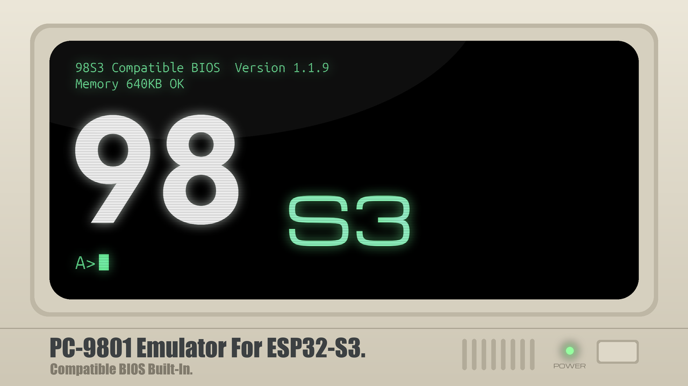
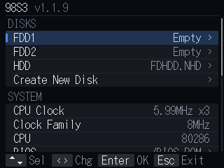

# 98S3





A **PC-9801 emulator for the ESP32-S3**. It is a port of 98TAB5 (for the M5Stack Tab5) to the ESP32-S3; the
emulator itself (the CPU and the devices) is shared with 98TAB5.

日本語: [README.jp.md](README.jp.md)

---

## 1. Features

### Built-in compatible ROMs

A simple BIOS and a public-domain font are built in.
**It boots from an empty microSD card, without ROMs from a real machine.**
The so-called NEC protection is not supported: to use NEC MS-DOS, or games that include it, extract the BIOS
from a real machine. N88(86)-BASIC is not supported, for copyright reasons.

### USB keyboard / mouse

Connected to the ESP32-S3's USB port.

### Bluetooth keyboard / mouse

BLE only. Devices that need a passkey entered are not supported.

### Screenshots

Saves a hard copy of the screen to the microSD card as a PNG file.

### SD Card Reader mode

Mounts the microSD card as a folder on a PC connected to the ESP32-S3's USB port.
Transfers are very slow. Bluetooth is stopped while the mode runs. Reset the board to leave it.

### Disk Image Reader mode

Mounts the disk image in use as a folder on a PC connected to the ESP32-S3's USB port: the HDD, or a floppy
image in FDD1 / FDD2 (`.NFD` `.D88` `.HDM` `.FDI`).
Transfers are very slow. Bluetooth is stopped while the mode runs. Reset the board to leave it.

### 386 instructions (partial)

With **CPU: 80286 + 386 Instructions** in the menu (the default), some real-mode software that uses 386
instructions runs. Protected mode is not supported. The machine identifies itself as a 286.

### Screen reduction

The 640x400 screen is reduced to the panel's resolution (320x200). The way it is reduced is chosen with
**Scaling** in the menu.

---

## 2. Hardware

| Part | Connection |
|---|---|
| ESP32-S3 N16R8 | 16MB flash, 8MB PSRAM |
| LCD ST7789 320x240 (SPI) | MOSI 11, SCLK 12, CS 10, DC 9, RST 13 |
| microSD (SPI) | CS 4, SCK 5, MISO 6, MOSI 7 |
| I2S amplifier MAX98357A | BCLK 38, LRCLK 39, DOUT 40 |
| USB | the ESP32-S3's USB port (keyboard / mouse; the PC in SD Card Reader / Disk Image Reader mode) |
| Bluetooth | the ESP32-S3's own BLE |

- Format the microSD card as FAT32.
- The emulated extended memory is 2MB.

---

## 3. Building

### (1) Build

A plain ESP-IDF project (no Arduino core, no PlatformIO).

**ESP-IDF v5.5 is required. It does not build with v6.x.**

```sh
cd 98S3
. $HOME/esp/esp-idf/export.sh     # where v5.5 is installed
idf.py build
```

No `idf.py set-target` is needed (the target is set in `sdkconfig.defaults`).
The first build takes a few minutes to fetch the components.

`./build.sh` does the same (it looks for ESP-IDF by itself).

### (2) Flashing

```sh
idf.py -p <PORT> flash
```

`<PORT>` is the port of the board's serial (UART) USB socket. `./flash.sh [PORT]` does the same.

#### Flashing without the toolchain

Built firmware is in [`firmware/`](firmware/).

For a new installation, write the combined image (bootloader, partition table and app):

```sh
python -m esptool --chip esp32s3 --port <PORT> --baud 460800 write_flash 0x0 firmware/98S3-public-1.2.0-20261109.bin
```

To update from the same partition layout, write the app alone. This keeps the disk choices, CPU clock, volume
and Bluetooth pairings saved in NVS.

```sh
python -m esptool --chip esp32s3 --port <PORT> --baud 460800 write_flash 0x10000 firmware/pc98s3-app.bin
```

Writing the combined image may overwrite the settings.
See [`firmware/README.jp.md`](firmware/README.jp.md) for details.

#### Resetting the settings

To start completely afresh:

```sh
esptool --chip esp32s3 -p <PORT> erase-flash    # then write as above
```

To clear the settings only, keeping the firmware:

```sh
esptool --chip esp32s3 -p <PORT> erase-region 0x9000 0x5000
```

---

## 4. Starting

Put disk images (`.NFD`, `.NHD` and so on) in the root of a FAT32 microSD card, insert it and power on: the
built-in compatible BIOS starts.

**F11 / F12 / Pause** opens the built-in menu.

Choose disk images for FDD1 / FDD2 / CD-ROM / HDD and leave the menu with **Reset**: the machine restarts with them
mounted.

CD-ROM takes a CD image (`.ISO` or `.CUE`). To use it from DOS, load `CD98.SYS` and
`CDEX98.COM` (or MSCDEX) from `tools/cd98`.

If you have `BIOS.ROM` or `FONT.ROM` dumped from a real machine, put them in the root of the microSD card and
choose them in the menu. They take precedence over the built-in ROMs.

### Connecting Bluetooth devices

**Pairing stays open until both a keyboard and a mouse are connected, with no time limit.**

- A device connects when it is switched on, right after power-up or any time later.
- Wake a sleeping device by pressing a key or moving the mouse.
- Pairing stops once a keyboard and a mouse are both connected.

## 5. Notes

- MIDI is not supported.

---

## 6. Licence

The licence of this program itself, including the built-in compatible BIOS, is the **MIT licence**.

Libraries and sources it uses carry their own licences. See **[LICENSE.md](LICENSE.md)** (English, authoritative)
or **[LICENSE.jp.md](LICENSE.jp.md)** (Japanese).

---

Copyright 2026 mochimochi-man / X: [@MochimochimanEX](https://x.com/MochimochimanEX)
