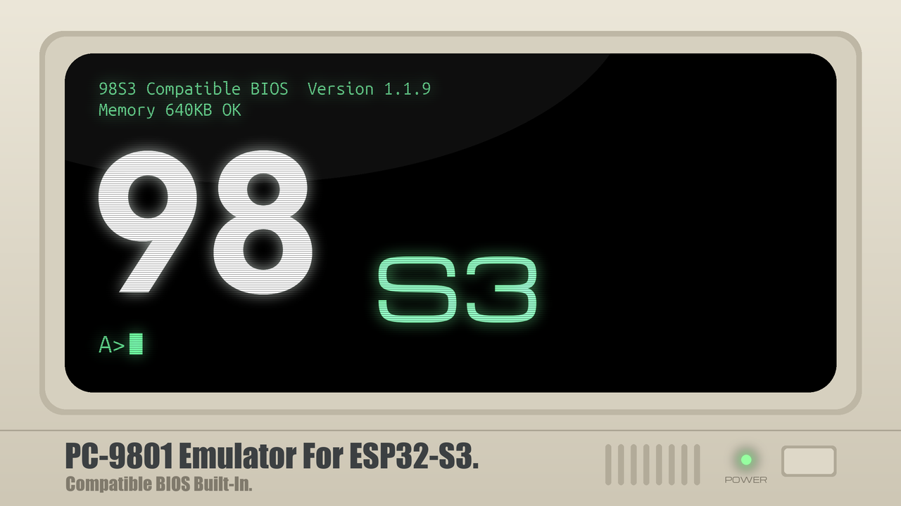
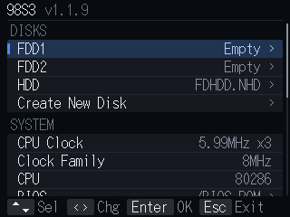

# 98S3





**ESP32-S3 用 PC-9801 エミュレータ**です。M5Stack Tab5 用の 98TAB5 を ESP32-S3 に移植したもので、
エミュレータ本体（CPU とデバイス）は 98TAB5 と共通です。

English: [README.en.md](README.en.md)

---

## 1. 特徴

### 互換 ROM 内蔵

簡易 BIOS とパブリックドメインのフォントを内蔵しています。
**実機の ROM が無くても、空の microSD カードだけで起動します。**
ただし、俗にいう NEC プロテクトには対応しませんので、 NEC 製 MS-DOS やこれを含むゲームを利用されたい方は、
実機から BIOS を抽出する必要があります。また、 N88(86)-BASIC には著作権の都合上、対応しません。

### USB キーボード / マウス対応

ESP32-S3 の USB 端子に接続します。

### Bluetooth キーボード / マウス対応

BLE のみ対応。パスコード入力を要するタイプの機器には対応しません。

### スクリーンショット機能

画面のハードコピーを microSD に PNG 形式で保存します。

### SD Card Reader モード

挿入された microSD を、ESP32-S3 の USB 端子につないだ PC のフォルダとしてマウントできます。
転送速度は非常に遅いです。モード中は Bluetooth が停止します。抜けるには本体をリセットしてください。

### Disk Image Reader モード

マウント中のディスクイメージを、ESP32-S3 の USB 端子につないだ PC のフォルダとしてマウントできます。
対象は HDD、または FDD1 / FDD2 のフロッピーイメージ（`.NFD` `.D88` `.HDM` `.FDI`）です。
転送速度は非常に遅いです。モード中は Bluetooth が停止します。抜けるには本体をリセットしてください。

### 386 命令簡易対応

メニューの **CPU: 80286 + 386 Instructions**（既定）で、386 命令を使う
リアルモードのソフトが一部動作します。プロテクトモードには対応しません。
CPU 判定には 286 として応答します。

### 画面の縮小

640x400 の画面を液晶の解像度（320x200）に縮小して表示します。縮小の方法はメニューの
**Scaling** で選べます。

---

## 2. ハードウェア

| 部品 | 接続 |
|---|---|
| ESP32-S3 N16R8 | フラッシュ 16MB、PSRAM 8MB |
| 液晶 ST7789 320x240（SPI） | MOSI 11、SCLK 12、CS 10、DC 9、RST 13 |
| microSD（SPI） | CS 4、SCK 5、MISO 6、MOSI 7 |
| I2S アンプ MAX98357A | BCLK 38、LRCLK 39、DOUT 40 |
| USB | ESP32-S3 の USB 端子（キーボード / マウス。SD Card Reader / Disk Image Reader モードでは PC との接続） |
| Bluetooth | ESP32-S3 内蔵の BLE |

- microSD は FAT32 でフォーマットしてください。
- エミュレートする拡張メモリは 2MB です。

---

## 3. ビルド方法

### (1) ビルド

素の ESP-IDF プロジェクトです（Arduino コア・PlatformIO は使いません）。

**ESP-IDF v5.5 が必要です。v6.x ではビルドできません。**

```sh
cd 98S3
. $HOME/esp/esp-idf/export.sh     # v5.5 を入れた場所
idf.py build
```

`idf.py set-target` は不要です（`sdkconfig.defaults` でターゲット指定済み）。
初回ビルドはコンポーネントを取得するため数分かかります。

`./build.sh` でも同じことができます（ESP-IDF を自動で探します）。

### (2) 書き込み

```sh
idf.py -p <PORT> flash
```

`<PORT>` は、ボードのシリアル変換（UART）側の USB 端子が見えるポートです。
`./flash.sh [PORT]` でも同じです。

#### ツールチェーン無しで書き込む場合

ビルド済みファームウェアは [`firmware/`](firmware/) にあります。

新規に導入する場合は、ブートローダー・パーティションテーブル・アプリを含む結合イメージを書き込みます。

```sh
python -m esptool --chip esp32s3 --port <PORT> --baud 460800 write_flash 0x0 firmware/98S3-public-1.1.9-20261106.bin
```

同じパーティション構成から更新する場合は、アプリ単体を書き込みます。
この方法では、NVS に保存したディスク選択・CPU クロック・音量・Bluetooth のペアリング情報を維持できます。

```sh
python -m esptool --chip esp32s3 --port <PORT> --baud 460800 write_flash 0x10000 firmware/pc98s3-app.bin
```

結合イメージの書き込みでは設定が上書きされる場合があります。
詳細は [`firmware/README.jp.md`](firmware/README.jp.md) を参照してください。

#### 設定を初期化する場合

完全に初期状態から始めるには:

```sh
esptool --chip esp32s3 -p <PORT> erase-flash    # そのあと上記の書き込み
```

ファームウェアはそのままで設定だけ消すには:

```sh
esptool --chip esp32s3 -p <PORT> erase-region 0x9000 0x5000
```

---

## 4. 起動方法

ディスクイメージ（`.NFD` または `.NHD` など）を FAT32 でフォーマットした microSD
カードのルートに入れ、挿入して電源を入れると、内蔵の互換簡易 BIOS が起動します。

**F11 / F12 / Pause** のいずれかで内蔵メニューが開きます。

FDD1 / FDD2 / HDD に任意のディスクイメージを指定し、**Reset** でメニューを抜けると、
指定したディスクイメージをマウントして再起動します。

実機から吸い出した `BIOS.ROM` や `FONT.ROM` がある場合は、microSD のルートに置いて
メニューで指定してください。内蔵 ROM より優先されます。

### Bluetooth 機器の接続

キーボードとマウスの両方が接続されるまで、**待ち受けは止まりません。時間制限は
ありません。**

- 電源投入後でも、しばらく経ってからでも、機器の電源を入れれば繋がります。
- 休止している機器は、キーを押す・マウスを動かすなどして起こしてください。
- キーボードとマウスが揃った時点で待ち受けを停止します。

## 5. 留意事項

- MIDI には対応していません。

---

## 6. ライセンス

内蔵の互換簡易 BIOS を含む本プログラム固有のライセンスは **MIT ライセンス**です。

ただし、採用しているライブラリやソースごとに固有のライセンスがあります。
詳細は **[LICENSE.jp.md](LICENSE.jp.md)**（日本語）または
**[LICENSE.md](LICENSE.md)**（英語・正式版）を参照してください。

---

Copyright 2026 mochimochi-man / X: [@MochimochimanEX](https://x.com/MochimochimanEX)
